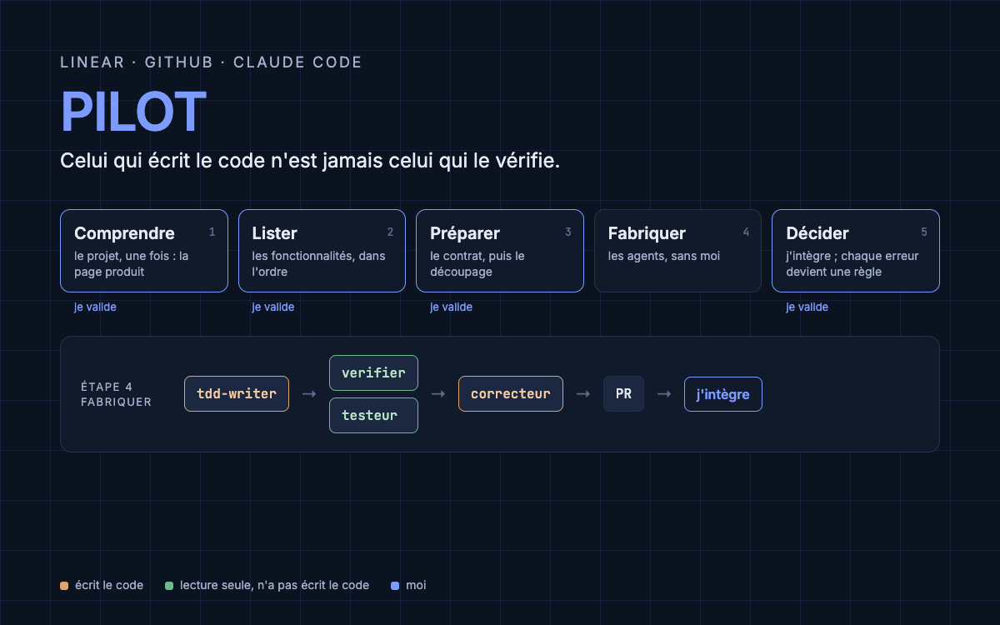
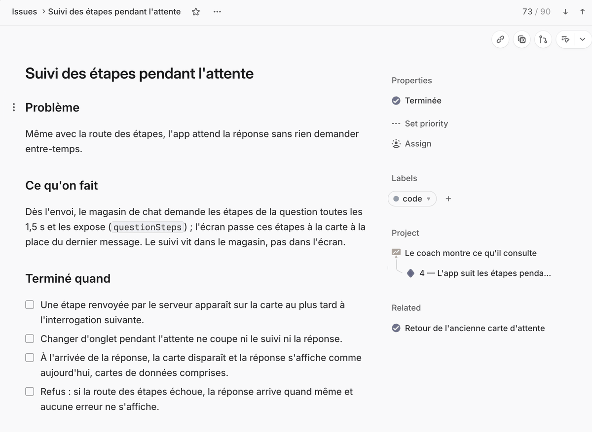
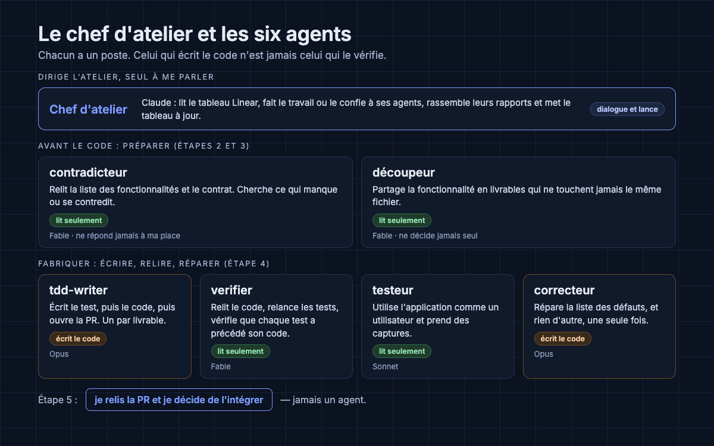
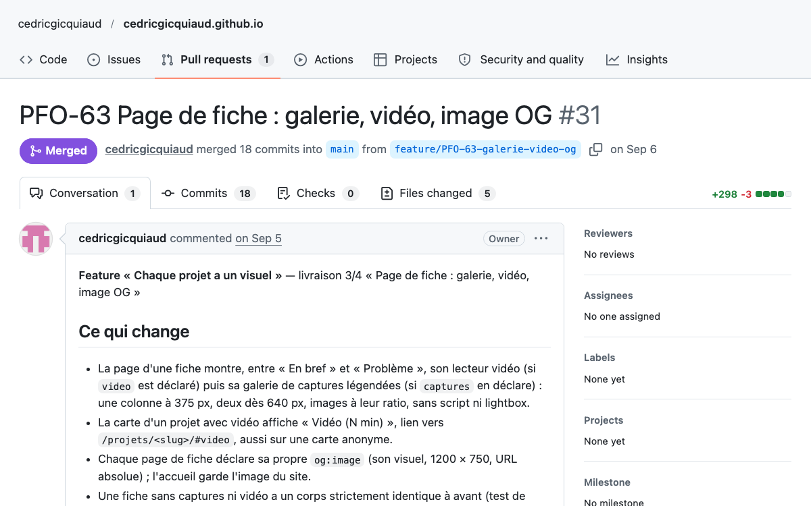

# pilot

_A method to run a software project with Linear, GitHub and Claude Code: AI agents frame, build,
review and fix the code, and I merge. Documentation in French; agent prompts and tools in
`implementation/`._



Une méthode pour mener un projet logiciel avec Linear, GitHub et Claude Code — et le code qui
la fait tourner. Je l'ai conçue pour une raison simple : avec des agents de code, écrire n'est
plus le goulot, vérifier l'est. Alors celui qui écrit le code n'est jamais celui qui le
vérifie, et c'est moi qui merge.

Ce dépôt contient les deux : les documents qui expliquent la méthode, et son implémentation,
qui s'installe dans chaque projet.

## Le principe

PILOT fait avancer un projet en cinq étapes. Je décide aux moments clés. Entre deux décisions,
Claude et ses agents travaillent seuls.

| | |
|---|---|
| **Linear** | Le tableau de bord. Ce qu'on fait, dans quel ordre, où on en est. |
| **GitHub** | L'atelier. C'est là que vit le code. |
| **Claude Code** | Le chef d'atelier. Il lit le tableau, fait le travail ou le confie à ses agents, puis met le tableau à jour. |

Une seule règle fait tenir l'ensemble : **le code de la tâche Linear voyage dans le nom de la
branche et dans le titre de la PR.** Tout le reste en découle — Linear lit GitHub et se met à
jour seul.

## Le vocabulaire

Quatre étages, du plus large au plus fin. Les noms sont imposés, parce qu'un mot flottant
finit par désigner deux choses.

| Dans Linear | Chez nous | Durée |
|---|---|---|
| Team | **Projet** | des mois |
| Project | **Feature** | des semaines |
| Milestone | **Livrable** — une PR | des jours |
| Issue | **Tâche** | des heures |

Ne jamais dire « projet » pour un Project Linear : c'est une feature.

## Les cinq étapes

1. **Comprendre le projet** (`init`, une fois). Claude fait une recherche approfondie sur l'état
   de l'art et les meilleures pratiques du domaine, m'interroge par séries de questions en
   proposant chaque fois une réponse, puis écrit la page produit. Je valide.
2. **Faire la liste des fonctionnalités** (`roadmap`). Claude les propose dans l'ordre ; le
   contradicteur, un agent qui ne fait que chercher ce qui manque, la relit. Je valide.
3. **Préparer une fonctionnalité** (`feature`). D'abord le contrat : 10 à 30 phrases
   vérifiables, dont au moins un tiers disent ce qui doit être impossible. Puis le découpeur la
   partage en livrables qui ne touchent jamais le même fichier, pour les fabriquer en même
   temps. Je valide les deux.

   

   _Une tâche réelle de l'application mobile de santé, dans Linear : le problème, ce qu'on fait,
   et la liste « Terminé quand », refus compris, que les agents doivent tenir._

4. **Fabriquer** (`run`), la seule étape sans moi. Chaque livrable a sa copie du projet. Le
   tdd-writer écrit le test, vérifie qu'il échoue, puis écrit le code ; chaque étape est
   enregistrée à part, l'historique le prouve. Le verifier relit le code et le testeur utilise
   l'application ; aucun des deux ne l'a écrit, aucun ne le modifie. Le correcteur répare leur
   liste de défauts, une seule fois. La PR s'ouvre avec son rapport, puis tout s'arrête.

   

5. **Décider et apprendre** (merge, puis `sync`). **C'est moi qui merge**, jamais un agent : un
   verrou technique les en empêche. Claude remet Linear à jour, et chaque erreur qui pourrait
   revenir devient une règle écrite que les agents liront la fois suivante.

   

   _Une PR réelle de mon site, écrite par l'agent : le code de la tâche dans le titre, ce qui
   change expliqué en clair. C'est moi qui l'accepte._

Trois invariants, jamais négociés :

1. **Le merge est humain**, à chaque livrable.
2. **Les décisions de fond remontent**, elles ne se tranchent pas en chemin.
3. **Pas de code sans test préalable** (Test Driven Development) : l'historique des commits en
   est la preuve, et un agent la contrôle.

## Les six agents

Fable sert à juger, Opus à fabriquer, Sonnet à exécuter.

| Agent | Ce qu'il fait | Ce qu'il ne fait jamais | Modèle |
|---|---|---|---|
| contradicteur | Cherche ce qui manque ou se contredit | Répondre à ma place | Fable |
| découpeur | Partage le travail en livrables qui ne se gênent pas | Décider seul | Fable |
| tdd-writer | Écrit le test, puis le code, puis ouvre la PR | Sortir de son livrable | Opus |
| verifier | Relit le code et vérifie les preuves | Corriger | Fable |
| testeur | Utilise l'application et prend des captures | Corriger | Sonnet |
| correcteur | Répare la liste des défauts, une seule fois | Toucher à autre chose | Opus |

## Ce que ça donne

Utilisée sur mes projets réels (mon site portfolio : 67 livraisons depuis fin août, un projet
client, une application mobile), après un rodage sur un projet d'essai complet :

- **8 défauts** attrapés par le verifier derrière des tests verts, tous corrigés avant la PR ;
- **0,66 h** de session pour une fonctionnalité que mon barème estimait à 2,44 h ;
- **23 livrables** et 67 tâches livrées sur le projet d'essai, trois tdd-writer en parallèle
  sans conflit.

Le détail : [la fiche PILOT](https://cedricgicquiaud.github.io/projets/pilot/).

## Les fichiers

| Fichier | Ce qu'on y trouve |
|---|---|
| [`PILOTAGE-LINEAR-GITHUB-CLAUDE.md`](PILOTAGE-LINEAR-GITHUB-CLAUDE.md) | La méthode complète. Partie A : le suivi Linear/GitHub. Partie B : le circuit d'une feature et les commandes. |
| [`circuit-linear-github-claude.html`](circuit-linear-github-claude.html) | La même chose en cinq écrans, à ouvrir dans un navigateur. Support de présentation. |
| [`BOUCLE-AGENTS.md`](BOUCLE-AGENTS.md) | La boucle d'agents : pourquoi, les briques, les leçons de chaque essai, ce qui manque encore. Journal de bord autant que méthode. |
| [`implementation/`](implementation/) | Ce que Claude Code lit pour travailler : six fiches d'agent, la skill `pilot`, trois skills importées, trois outils. |
| [`GRILLE-DE-RELECTURE.md`](GRILLE-DE-RELECTURE.md) | Les huit questions à poser à chaque phrase d'une fiche avant de la modifier. |
| `.out-of-scope/` | Les idées essayées ou étudiées et écartées, avec la raison, pour ne pas rouvrir le débat sans élément nouveau. |

Pour comprendre la méthode, commence par le HTML — cinq minutes. Pour la mettre en œuvre, lis
la Partie B du Markdown.

## Quelle commande, dans quelle situation

| Tu veux… | Tape | Claude s'arrête quand |
|---|---|---|
| Savoir où en est le projet et quoi faire ensuite | `/pilot next` | Il a proposé l'étape logique |
| Démarrer un projet | `/pilot init` | Le PRD est à valider |
| Poser toutes les features | `/pilot roadmap` | La liste est à valider |
| Ouvrir une feature | `/pilot feature <nom>` | Le cadrage, puis le découpage, sont à valider |
| Fabriquer les livrables | `/pilot run <feature>` | Les PR sont ouvertes et auditées ; tu merges |
| Remettre Linear d'aplomb après un merge | `/pilot sync` | Il enchaîne sur `next` |
| Corriger un bug ou faire une retouche hors feature | `/pilot fix <description>` | La PR est ouverte |
| Comprendre un bug qui ne se reproduit pas | dis « diagnostique » | La cause est nommée |
| Sortir d'un merge en conflit | dis « le merge bloque » | Le merge est terminé |
| Faire trancher le client | `/to-questionnaire` | Le document à lui envoyer est écrit |
| Mettre la méthode d'un projet à jour | `/pilot update` | Le commit est à valider |

Dans l'usage courant, `next` suffit : chaque commande finit en proposant la suivante.

## Installer la méthode dans un projet

```bash
git clone git@github.com:cedricgicquiaud/pilot-method.git
cd pilot-method
./install.sh /chemin/vers/ton/projet
```

Le script copie les fiches d'agent, la skill et les outils dans le `.claude/` du projet. **La
méthode est ensuite versionnée avec ce projet** : qui le clone reçoit le code et la méthode
dans le même geste, et deux personnes ne peuvent pas travailler avec des versions différentes
sans le voir.

Ensuite, dans le projet :

```bash
claude
/pilot init
```

`init` mène l'entretien de cadrage, écrit le PRD, crée la team Linear et pose les meubles dans
le dépôt.

## Mettre à jour un projet

Depuis le projet, `/pilot update`. Il va chercher la dernière version, dit en trois lignes ce
qui change pour ton travail, et commite. Il refuse de tourner pendant qu'un livrable est en
cours : un agent lancé avec les anciennes fiches ne doit pas finir avec les nouvelles.

## La règle qui tient tout

**On modifie la méthode ici, jamais dans un projet.** Ce qu'un projet contient dans son
`.claude/` est une copie ; la modifier ne remonte nulle part, et la prochaine mise à jour
l'écrase.

Une amélioration se fait dans ce dépôt, sur une branche, avec une pull request.

## Pré-requis

- Un compte Linear (le plan gratuit suffit : deux teams par workspace) et son intégration
  GitHub activée
- Un dépôt GitHub par projet
- Claude Code
- Node et Python 3 pour les deux outils

## Licence

- Les textes (documents, fiches d'agent, skills) : [CC BY 4.0](https://creativecommons.org/licenses/by/4.0/deed.fr).
  Réutilisation libre, en citant l'auteur.
- Le code (`install.sh`, scripts et outils de `implementation/`) : MIT, voir [`LICENSE`](LICENSE).
- Les trois skills importées de [`mattpocock/skills`](https://github.com/mattpocock/skills)
  gardent leur licence MIT, jointe dans leur dossier.
